# 💻 Paulo César | Portfólio Profissional

<table>
  <tr>
    <td width="800">
      <div align="justify">
        Portfólio pessoal desenvolvido com React e Vite para apresentar um pouco sobre mim, meus projetos e minhas habilidades técnicas como estudante de Engenharia de Software e desenvolvedor Full Stack em formação. A aplicação é bilíngue (PT/EN), a interface simula um editor de código e é responsiva, possui órbita 2D interativa com as tecnologias que utilizo, visualizador de currículo em PDF e formulário de contato com envio direto para o meu e-mail. Além de ser minha vitrine profissional, o projeto também é um laboratório para aplicar boas práticas engenharia de software.
      </div>
    </td>
    <td width="150" align="center">
      <div>
        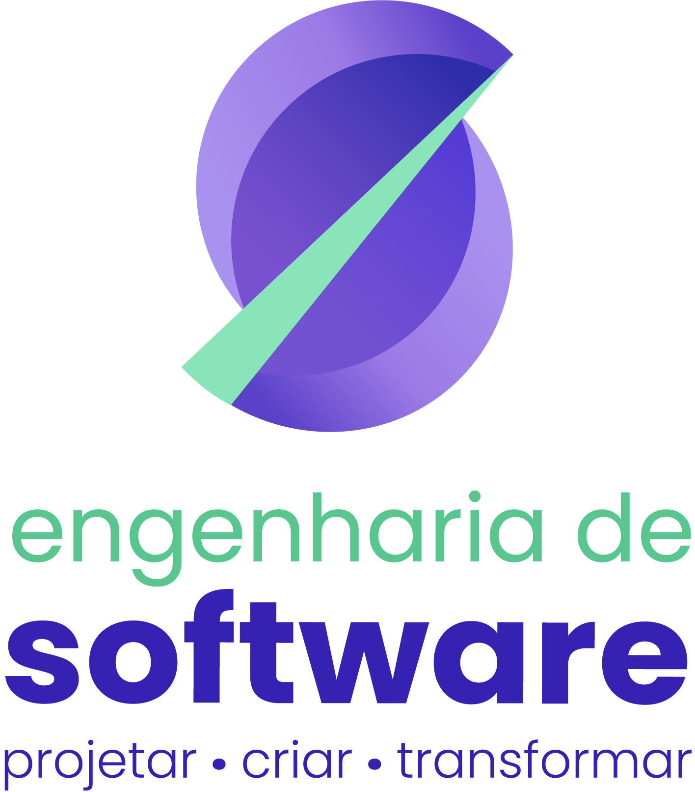
      </div>
    </td>
  </tr>
</table>

[](https://github.com/PauloCesar0709/portfolio/releases)        

---

## 📚 Índice

- [Links Úteis](#-links-úteis)
- [Sobre o Projeto](#-sobre-o-projeto)
- [Funcionalidades Principais](#-funcionalidades-principais)
- [Tecnologias Utilizadas](#-tecnologias-utilizadas)
- [Instalação e Execução](#-instalação-e-execução)
  - [Pré-requisitos](#pré-requisitos)
  - [Variáveis de Ambiente](#-variáveis-de-ambiente)
  - [Como Executar](#-como-executar)
  - [Scripts Disponíveis](#-scripts-disponíveis)
- [Deploy](#-deploy)
- [Estrutura de Pastas](#-estrutura-de-pastas)
- [Protótipos](#-protótipos)
- [Demonstração](#-demonstração)
- [Documentações utilizadas](#-documentações-utilizadas)
- [Agradecimentos](#-agradecimentos)
- [Licença](#-licença)

---

## 🔗 Links Úteis

* 🌐 **Aplicação Web:** [Acesse o portfólio](https://paulocesar.vercel.app)
  > **Descrição:** Versão em produção do portfólio, hospedada na Vercel.
* 📦 **Repositório:** [Bernardo-Guedes/portfolio](https://github.com/PauloCesar0709/portfolio-paulocesar)
  > **Descrição:** Código-fonte do projeto no GitHub.

---

## 📝 Sobre o Projeto

Este portfólio nasceu da necessidade de reunir em um só lugar um pouco sobre minha trajetória como estudante de Engenharia de Software: projetos, experiências, habilidades técnicas e formas de contato. Em vez de depender apenas de um currículo em PDF ou de perfis espalhados em diferentes plataformas, a ideia é oferecer uma apresentação profissional, organizada e fácil de navegar para recrutadores, professores e outros desenvolvedores.

O projeto foi desenvolvido no contexto acadêmico da **PUC Minas**, mas com foco em uso real: ele serve como minha vitrine profissional e pode ser compartilhado em processos seletivos, candidaturas a estágio e networking. Quem visita encontra rapidamente quem sou, o que já construí (com links para os repositórios no GitHub) e como falar comigo, em português ou inglês.

Também é um projeto de aprendizado: ele me permite aprofundar conhecimentos em React, Tailwind CSS, internacionalização, animaçõe e boas práticas como documentação, versionamento, prototipação no Figma e organização de código.

---

## ✨ Funcionalidades Principais

- 🏠 **Home:** cartão de visitas do portfólio, apresenta meu nome, minha formação e um slogan que define bem o que faço
- 🙋 **Sobre mim:** perfil, minhas formações e uma tabela que mostra o que gosto quando não estou programando
- 🗂️ **Projetos em destaque:** seção com cards que mostram meus principais projetos, uma breve descrição, linguagens utilizadas e o link para o github
- 💫 **Stack tecnológica:** uma órbita 2D interativa que representa as tecnologias que aprendi até agora em minha jornada
- 📄 **Currículo:** visualizador de PDF com zoom, download e abertura em nova aba, com arquivo diferente por idioma.
- ✉️ **Contato:** validação de campos, links de redes sociais e envio por e-mail via EmailJS. A página simula um arquivo json.
- 💻 **Interface que simula editor de código:** barra lateral que simula pastas de um arquivo, além de cores e designs projetados para simular um editor de código real
- 🌎 **Bilíngue (PT/EN):** alternância na barra do explorador; o idioma inicial considera o parâmetro `?lang=`, a escolha salva e o idioma do navegador.
- 📱 **Responsivo:** menu mobile, layouts adaptados e efeitos desativados onde não fazem sentido.

---

## 🛠 Tecnologias Utilizadas

### 💻 Front-end

* **Biblioteca:** [React 19](https://react.dev/)
* **Build Tool:** [Vite](https://vite.dev/)
* **Estilização:** [Tailwind CSS 4](https://tailwindcss.com/), [tw-animate-css](https://github.com/Wombosvideo/tw-animate-css) e variáveis CSS para os temas
* **Animações:** [Motion](https://motion.dev/)
* **Visualização de PDF:** [react-pdf](https://github.com/wojtekmaj/react-pdf) (PDF.js)
* **Internacionalização (PT/EN):** [i18next](https://www.i18next.com/) e [react-i18next](https://react.i18next.com/)
* **Ícones:** [Lucide](https://lucide.dev/) e [React simple icons](https://github.com/icons-pack/react-simple-icons)
* **Fonte:** [Font source](https://fontsource.org/)

### 🖥️ Serviços Externos
 
O projeto **não possui back-end próprio**. O único serviço externo é:
 
* **Envio de e-mail (formulário de contato):** [EmailJS](https://www.emailjs.com/)

---

### ⚙️ Infraestrutura e Ferramentas
 
* **Hospedagem:** [Vercel](https://vercel.com/)
* **Análise estática:** [ESLint](https://eslint.org/) com `typescript-eslint` e `eslint-plugin-react-hooks`
* **Protótipos:** [Figma](https://www.figma.com/)
* **Versionamento:** [Git](https://git-scm.com/) e [GitHub](https://github.com/)

---

## 🔧 Instalação e Execução
 
### Pré-requisitos
 
* **Node.js:** versão **22.13** ou superior (o Vite 8 exige 20.19+/22.12+, e o `pdfjs-dist` pede 22.13+)
* **Gerenciador de pacotes:** npm (já incluso no Node.js)
* **Conta no [EmailJS](https://www.emailjs.com/)** (opcional, apenas para testar o envio do formulário de contato)
---

### 🔑 Variáveis de Ambiente
 
Crie um arquivo **`.env.local`** na raiz do projeto (ele não é versionado). O prefixo `VITE_` é obrigatório para que o Vite exponha as variáveis ao código do navegador.
 
| Variável | Descrição |
| :--- | :--- |
| `VITE_EMAILJS_SERVICE_ID` | ID do serviço de e-mail configurado no EmailJS. |
| `VITE_EMAILJS_TEMPLATE_CONTACT` | ID do template de e-mail do EmailJS. |
| `VITE_EMAILJS_PUBLIC_KEY` | Chave pública (*Public Key*) da sua conta EmailJS. |
 
```env
VITE_EMAILJS_SERVICE_ID=seu_service_id_aqui
VITE_EMAILJS_TEMPLATE_CONTACT=seu_template_id_aqui
VITE_EMAILJS_PUBLIC_KEY=sua_public_key_aqui
```

> 💡 O template do EmailJS deve usar as variáveis `{{from_name}}`, `{{reply_to}}` e `{{message}}`, que são as enviadas pelo formulário.
 
> ⚠️ Sem essas variáveis o site funciona normalmente, mas o envio do formulário de contato retornará erro. 
---

### ⚡ Como Executar
 
1. **Clone o repositório:**
```bash
git clone https://github.com/PauloCesar0709/portfolio-paulocesar.git
cd portfolio
```
 
2. **Instale as dependências:**
```bash
npm install
```
 
3. **Configure as variáveis de ambiente** (veja a seção anterior).
4. **Inicie o servidor de desenvolvimento:**
```bash
npm run dev
```
 
🎨 *A aplicação estará disponível em **http://localhost:5173**.*
  
---

### 📜 Scripts Disponíveis
 
| Script | Descrição |
| :--- | :--- |
| `npm run dev` | Inicia o servidor de desenvolvimento com *hot reload*. |
| `npm run build` | Verifica os tipos (`tsc -b`) e gera a versão de produção em `/dist`. |
| `npm run preview` | Serve localmente a build de produção para conferência. |
| `npm run lint` | Executa o ESLint em todo o projeto. |
 
---

## 🚀 Deploy
 
O projeto é hospedado na **Vercel**, com deploy automático a cada *push* na branch `main`.
 
1. **Gere a build de produção** (opcional, para conferir localmente):
```bash
npm run build
npm run preview
```
 
2. **Importe o repositório** na [Vercel](https://vercel.com/new). O Vite é detectado automaticamente (comando de build `npm run build`, pasta de saída `dist`).
3. **Configure as variáveis de ambiente** em *Project Settings > Environment Variables*:
```text
VITE_EMAILJS_SERVICE_ID
VITE_EMAILJS_TEMPLATE_ID
VITE_EMAILJS_PUBLIC_KEY
```
 
> 🔑 Como o EmailJS roda no navegador, a chave pública fica visível no *bundle*. Isso é esperado, mas vale restringir os domínios permitidos nas configurações da sua conta EmailJS.
 
---

## 📂 Estrutura de Pastas
 
```text
.
├── docs/                         # 📚 Documentação do projeto.
│   ├── prototipo/                # 🎨 Telas do protótipo do Figma.
│   └── images/                   # 🖼️ Imagens usadas neste README.
│
├── public/                       # 🌐 Arquivos públicos servidos diretamente.
│   ├── curriculo/                # 📄 Currículo em português e inglês.
│   ├── perfil/                   # 📸 Imagem de perfil
│   └── projetos/                 # 📸 Imagens dos projetos apresentados
│
├── src/                          # 💻 Código-fonte da aplicação React.
│   ├── components/               # 🧱 Componentes reutilizáveis (Sidebar, ContactForm, Cards, OrbitSystem...).
│   ├── pages/                    # 📄 Seções da página (Home, Sobre, Stack, Projetos, Curriculo, Contato).
│   ├── services/emailService.ts  # 🔌 Integração com o EmailJS.
│   ├── App.jsx                   # ⚛️ Composição das seções da aplicação.
│   ├── i18n.ts                   # 🌎 Configuração e textos PT/EN.
|   ├── data/                     # 🎲 dados utilizados na aplicação (Formação, stack, Projetos...)
│   ├── index.css                 # 🎨 Estilos globais, temas e tokens do Tailwind.
│   ├── hooks/                    # ✨ animações presentes na aplicação
│   └── main.tsx                  # 🚀 Ponto de entrada da aplicação.
│
├── .gitignore                    # 🚫 Arquivos e pastas ignorados pelo Git.
├── eslint.config.js              # ✨ Regras do ESLint.
├── index.html                    # 🌐 Documento HTML principal.
├── LICENSE                       # ⚖️ Licença do projeto.
├── package.json                  # 📦 Dependências, scripts e metadados.
├── package-lock.json             # 🔒 Versões exatas das dependências.
├── README.md                     # 📘 Documentação principal.
├── jsconfig.json                 # ⚙️ Configuração geral do JavaScript.
└── vite.config.ts                # ⚡ Configuração do Vite.
```
---

## 🎨 Protótipos

| Página Inicial | Página Sobre |
|----------------|----------------|
| 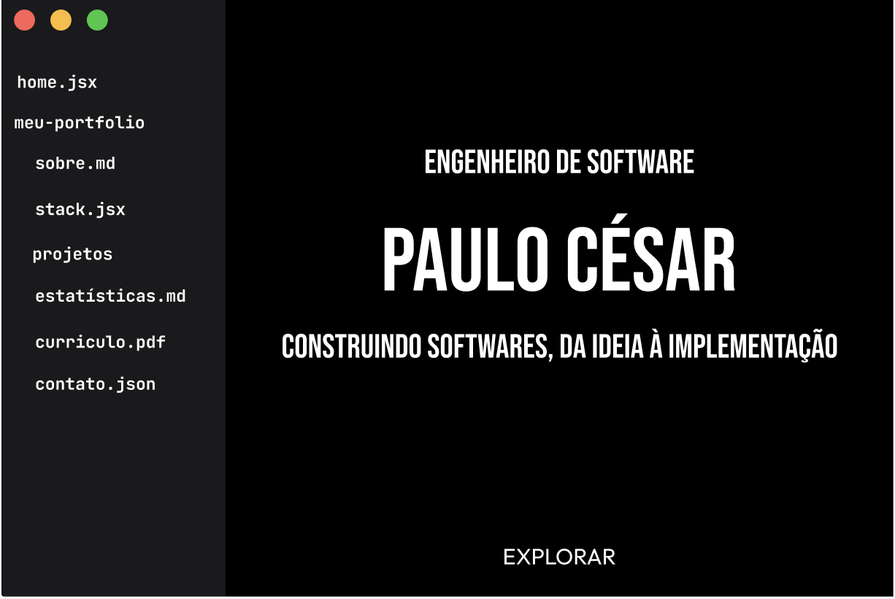 | 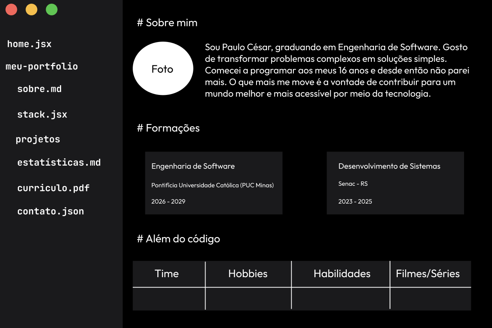 |

| Página Stack | Página Projetos |
|----------------|----------------|
| 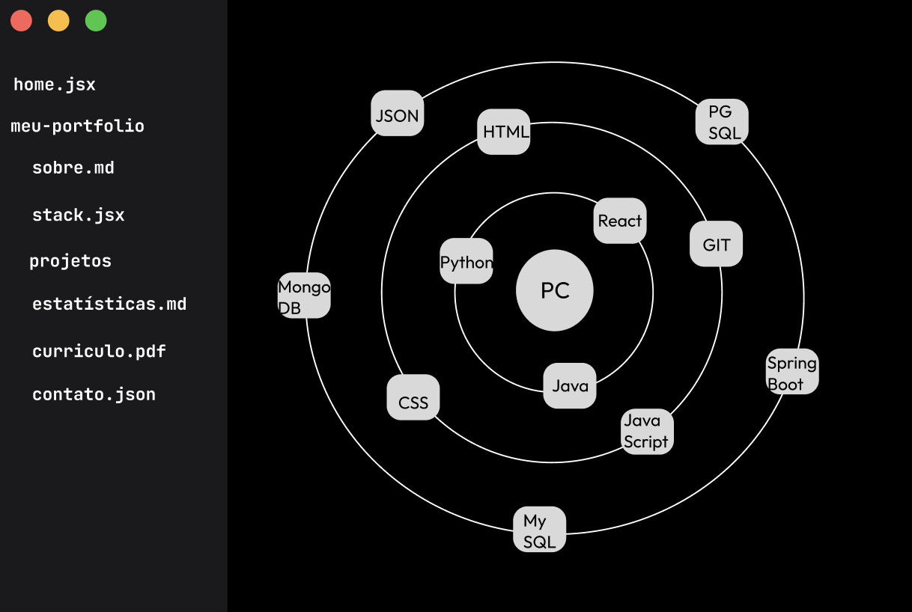 | 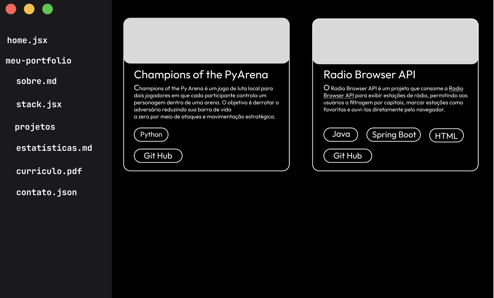 |

| Página Curriculo | Página Contato |
|----------------|----------------|
| 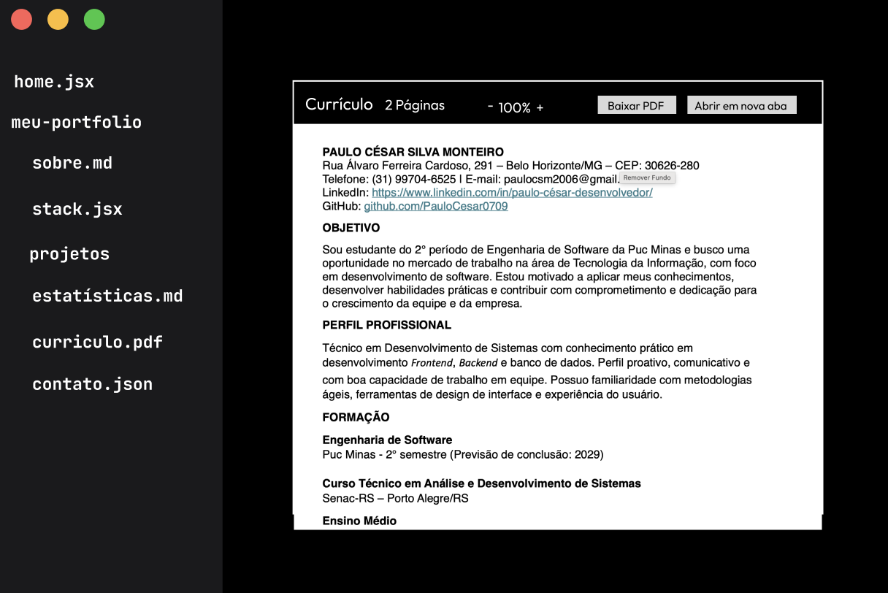 | 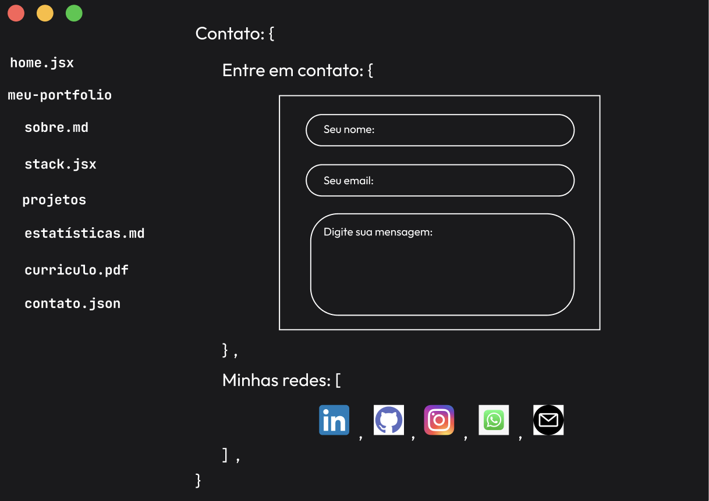 |

---

## 🎥 Demonstração

| Página Inicial |
|----------------|
| 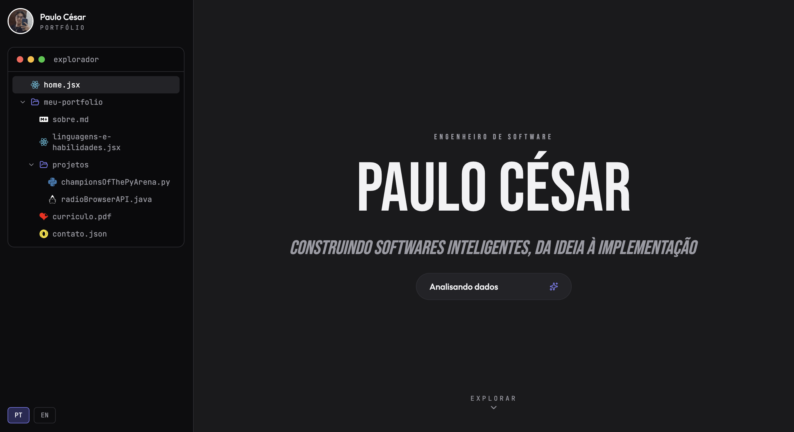 |

| Página Sobre |
|-----------------------------|
| 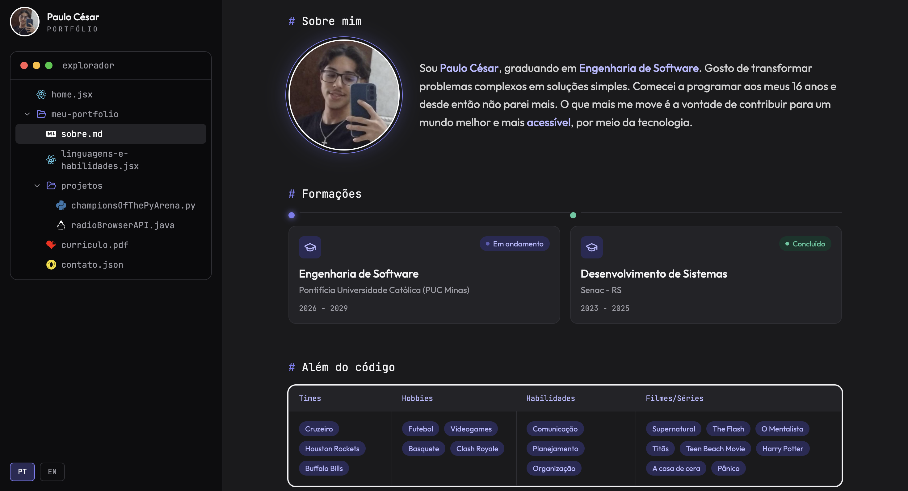 |

| Página Stack |
|----------------|
| 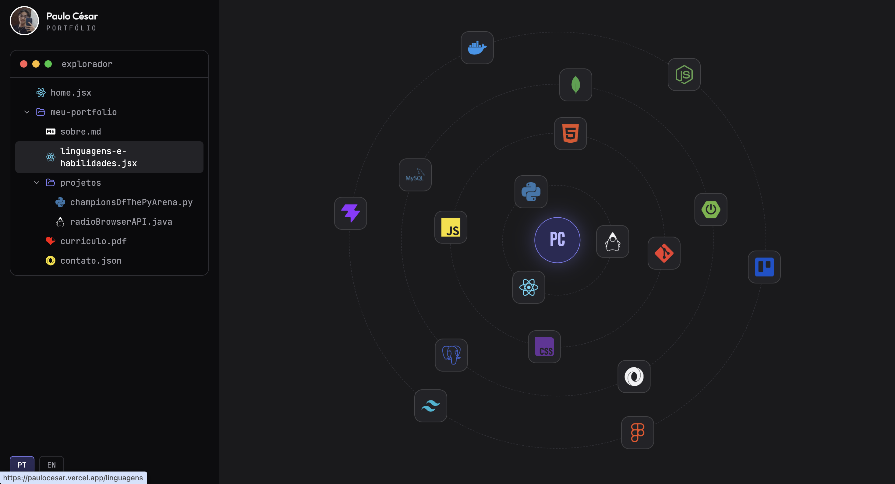 |

| Página Projetos |
|----------------|
| 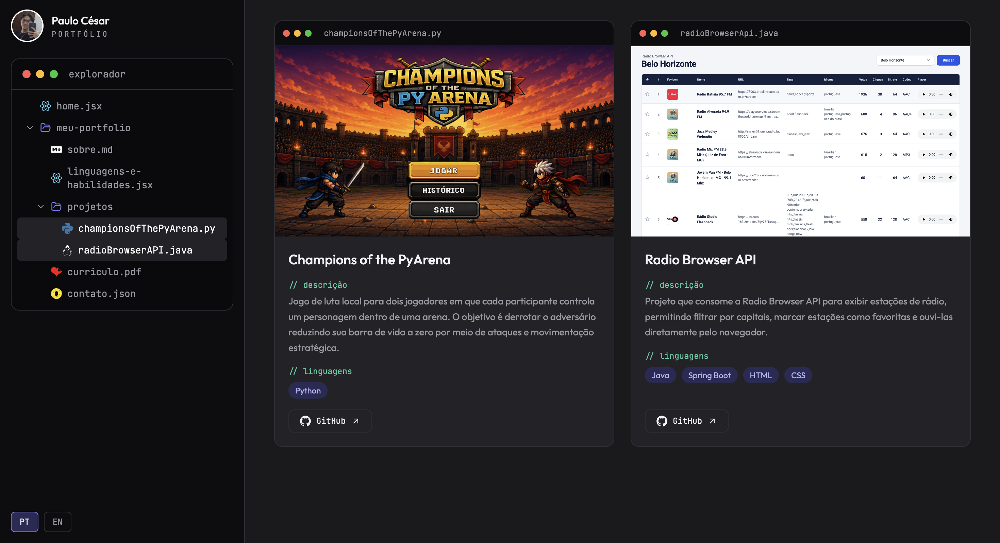 |

| Página Currículo |
|-----------------------------|
| 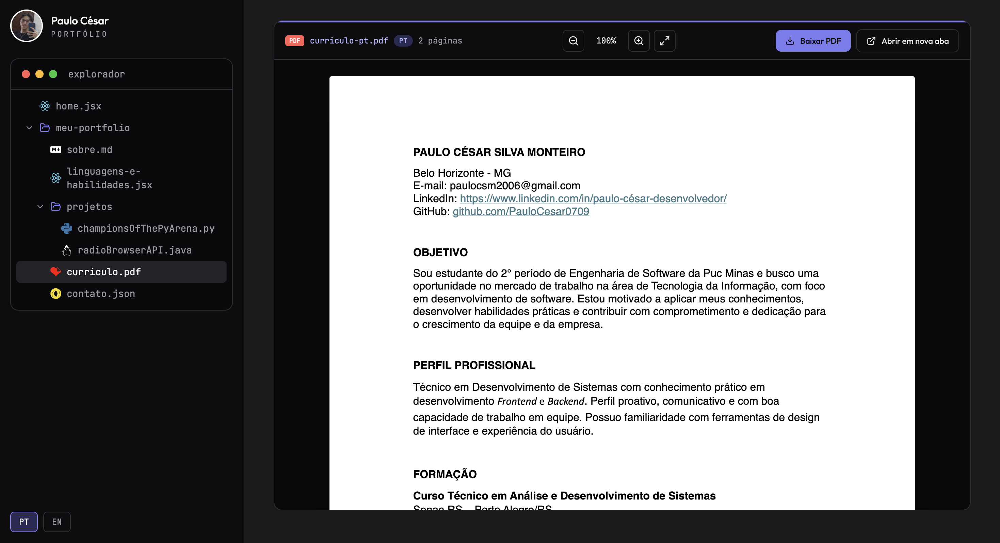 |


| Página Contato |
|-----------------------------|
| 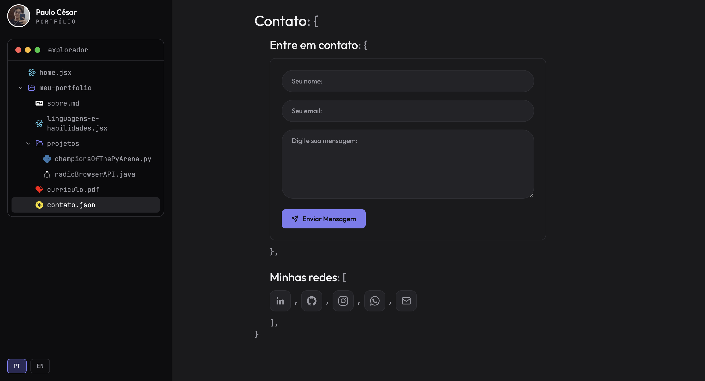 |


---

## 🔗 Documentações utilizadas
 
- 📖 **Biblioteca (Front-end):** [Documentação Oficial do React](https://react.dev/)
- 📖 **Build Tool:** [Guia de Configuração do Vite](https://vite.dev/guide/)
- 📖 **Estilização:** [Documentação Oficial do Tailwind CSS](https://tailwindcss.com/docs)
- 📖 **Animações:** [Documentação do Motion](https://motion.dev/docs/react)
- 📖 **PDF:** [Documentação do react-pdf](https://github.com/wojtekmaj/react-pdf#readme)
- 📖 **Internacionalização (i18n):** [Documentação do react-i18next](https://react.i18next.com/)
- 📖 **Ícones:** [Lucide React](https://lucide.dev/guide/packages/lucide-react) e [React simple icons](https://github.com/icons-pack/react-simple-icons)
- 📖 **Envio de E-mails:** [Documentação Oficial do EmailJS](https://www.emailjs.com/docs/)
- 📖 **Hospedagem e Deploy:** [Documentação Oficial da Vercel](https://vercel.com/docs)

---

## 🙏 Agradecimentos

Gostaria de agradecer aos seguintes canais e pessoas que foram fundamentais para o desenvolvimento deste projeto:

* [**Engenharia de Software PUC Minas**](https://www.instagram.com/engsoftwarepucminas/) - Pelo apoio institucional, estrutura acadêmica e fomento à inovação e boas práticas de engenharia.
* [**Prof. Dr. João Paulo Aramuni**](https://github.com/joaopauloaramuni) - Pelos valiosos ensinamentos sobre **Arquitetura de Software** e **Padrões de Projeto**.

---

## 📄 Licença

Este projeto é distribuído sob a **[Licença MIT](https://github.com/PauloCesar0709/portfolio-paulocesar/blob/main/LICENSE)**.

---
